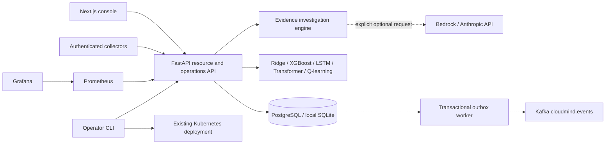

# Architecture

All authenticated operations resolve the environment through application/project ownership. Administrators may access all projects; DEVOPS is not a blanket cross-project grant. Viewers cannot mutate even their own resources. Cluster creation and deletion require ADMIN or DEVOPS. Public registration never grants elevated roles.

SQL stores metrics, policies, sessions and immutable event payloads. Decision event kinds transition from planned to executed to prevent replay. The Kafka worker sends committed outbox events and marks them delivered only after acknowledgement. A crash between send and marking can duplicate delivery; consumers must deduplicate by event ID. Kafka is optional; local functionality does not depend on it.

Ingestion requires timezone-aware timestamps, finite bounded measurements, batches of at most 1,000 records and a retention window. Duplicate environment/timestamp/source records are ignored. Queries are bounded. The forecast aggregates minute buckets and rejects gaps over five minutes. Stale measurements cannot produce a scaling plan. Models fit on demand; no untrusted pickle/model loading is used.

The simulator is deterministic and request-driven: viewing history advances minute samples, with up to 24 hours of catch-up. It is not an external production traffic generator. Active incidents last ten minutes. Simulation writes are explicitly labelled and cannot affect Kubernetes.

Production startup uses Alembic migrations. Development SQLite bootstraps tables. Redis supplies atomic shared authentication rate limits when configured; development has a bounded in-memory fallback. OIDC identities exchange short-lived single-use callback codes for normal sessions.

Advanced model artifacts persist under MODEL_STORE and belong to their environment. Training is serialized in the single API process. Keep one API replica until shared artifacts and a distributed training lock are introduced. Neural artifacts use non-executable NPZ; XGBoost uses JSON. Outbox failures leave events pending for retry; consumers deduplicate by ID.

Terraform describes the AWS estate and Helm describes the application. Static validation does not verify real account quotas, credentials, certificates or workload readiness. Those checks belong to deployment.
